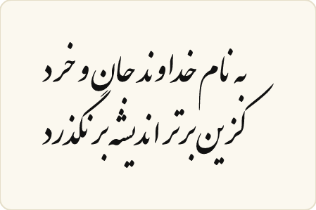

# nastaliq-bot 🖋️

ربات تلگرام و پلتفرم خوشنویسی نستعلیق آنلاین، کاملاً سرورلس بر بستر **Cloudflare Workers** با بهره‌گیری از **WebAssembly (HarfBuzz + Resvg)** بدون نیاز به هیچ سرور اختصاصی یا گیت‌هاب اکشنز.

A modern, 100% serverless Telegram bot and web platform that renders Persian text in authentic **Nastaliq calligraphy** directly inside **Cloudflare Workers** using **WebAssembly (HarfBuzz + Resvg)** — responding in milliseconds with zero external servers.

**[فارسی ⬇️](#فارسی)** | **[English ⬇️](#english)**

---

<p align="center">
  <a href="https://t.me/IRnastaliqbot">
    
  </a>
  <a href="https://nastaliq.startstar.ir">
    
  </a>
  
</p>

<p align="center">
  
  
</p>

---

## فارسی

### معماری جدید (۱۰۰٪ سرورلس روی Cloudflare Workers)

نسخه جدید این پروژه برخلاف روش‌های قدیمی که به سرورهای سنگین یا GitHub Actions (با تأخیر ۳۰ ثانیه‌ای) وابسته بودند، **کاملاً درون Cloudflare Workers** اجرا می‌شود:

```
کاربر در تلگرام / وب
         │
         ▼
 Cloudflare Worker (Edge)
         ├─ 1. دریافت وبهوک تلگرام یا درخواست وب
         ├─ 2. حروف‌چینی و اتصال حروف با HarfBuzz (WebAssembly)
         ├─ 3. استخراج مسیرهای برداری فونت (IranNastaliq / NotoNastaliq)
         ├─ 4. تبدیل مستقیم بردارها به تصویر PNG با Resvg (WASM)
         └─ 5. ارسال بلادرنگ عکس با متد sendPhoto تلگرام (< 1 ثانیه)
```

### امکانات جدید نسخه ۲

- 🚫🤖 **۱۰۰٪ فونت‌محور و بدون هوش مصنوعی:** تمام اشکال حروف دقیقاً از جداول فونت TrueType و شکل‌دهی HarfBuzz WASM استخراج می‌شوند.
- 🖋️ **۱۰ خط اصیل خوشنویسی:** `iran-nastaliq`، `shekasteh` (شکسته نستعلیق)، `dima-shekasteh`، `thuluth` (ثلث)، `naskh` (نسخ)، `kufi` (کوفی)، `mashgh` (مشق)، `davat` (دوات)، `termeh` (ترمه) و `noto-nastaliq`.
- 📜 **قالب‌بندی هوشمند شعر + کشیدگی (Kashida):** تفکیک خودکار دو ستونی ابیات با علامت `/`، درج نام شاعر در خط آخر با `-- نام شاعر` و تراز کشیده (`justify=true`).
- 🎨 **تم‌های ورق طلا و تذهیب:** `gold-leaf` (طلای متالیک + قاب تذهیب)، `tazhib` (تذهیب لاجورد و زر)، `gold`، `classic`، `night`، `rose`، `emerald`، `azure`، `sticker` و انتخاب رنگ دلخواه (`fgColor` / `bgColor`).
- 📐 **سایزهای Full-HD و خروجی وکتور SVG:** کادر مربعی `1080×1080` (پست اینستاگرام و پروفایل)، استوری `1080×1920`، بنر `1920×1080` و خروجی لایه‌باز `format=svg`.
- 🎛️ **تعامل زنده و استیکر پک در تلگرام:**
  - دکمه‌های شیشه‌ای زیر هر تصویر جهت تغییر لحظه‌ای فونت، تم، کادر، کشیدگی و دریافت وکتور SVG
  - افزودن مستقیم به **پک استیکر شخصی تلگرام** کاربر
  - خوشنویسی مستقیم روی عکس دلخواه (ارسال عکس با متن در کپشن)
  - استودیوی وب و مینی‌اپ تلگرام در `https://nastaliq.startstar.ir`

### دستورات ربات تلگرام (`@IRnastaliqbot`)

| دستور | عملکرد |
|---|---|
| `/start` یا `/help` | راهنمای کامل و لینک بازکردن استودیو مینی‌اپ |
| `/fonts` و `/font_<name>` | فهرست و انتخاب فوری ۱۰ خط خوشنویسی |
| `/themes` و `/theme_<name>` | انتخاب تم رنگی و طرح‌های تذهیب و ورق طلا |
| `/ratios` و `/ratio_<name>` | انتخاب نسبت کادر (`auto`, `square`, `story`, `horizontal`) |
| `/justify_on` و `/justify_off` | روشن/خاموش کردن تراز کشیده در ابیات شعر |
| `/sticker` و `/photo` | سوئیچ بین استیکر شفاف بدون حاشیه و کارت تصویری |
| `/svg` | دریافت فایل وکتور لایه‌باز SVG آخرین اثر |
| `/settings` | مشاهده تمام تنظیمات فعال کاربر |
| _(هر متن یا بیت شعر با `/`)_ | رندر فوری (خط آخر با `-- نام` به عنوان تخلص درج می‌شود) |
| `font=shekasteh theme=gold-leaf ratio=square: متن` | رندر یک‌باره با تنظیمات دلخواه |

### نحوه استقرار (Deploy)

۱. وارد پوشه `worker` شوید:
   ```bash
   cd worker
   npm install
   ```
۲. توکن‌ها را به صورت امن به عنوان Worker Secret ذخیره کنید:
   ```bash
   npx wrangler secret put TELEGRAM_BOT_TOKEN
   npx wrangler secret put TELEGRAM_WEBHOOK_SECRET
   ```
۳. فونت‌ها را داخل KV Namespace با شناسه `PREFS` بارگذاری و ورکر را مستقر کنید:
   ```bash
   npx wrangler deploy
   ```
۴. وبهوک تلگرام را همراه با `secret_token` به ورکر متصل نمایید:
   ```bash
   curl -X POST "https://api.telegram.org/bot<TOKEN>/setWebhook" \
     -d "url=https://<your-worker>.workers.dev" \
     -d "secret_token=<YOUR_WEBHOOK_SECRET>"
   ```

---

## English

### Architecture (100% On-Edge with WebAssembly)

Unlike previous setups that relayed jobs through external CI runners, this implementation executes **entirely on Cloudflare Workers**:
- **HarfBuzz WASM:** Performs proper Arabic/Persian contextual shaping, ligatures, and cursive attachment.
- **OpenType Engine:** Extracts exact vector glyph paths directly from TrueType font tables.
- **Resvg WASM:** Blazing-fast vector rasterizer compiling SVG directly to PNG buffers in ~15ms.

### Web Demo & API
- **Live Website:** [nastaliq.startstar.ir](https://nastaliq.startstar.ir)
- **Render API:**
  ```bash
  curl -X POST "https://nastaliq-bot.a77aslani.workers.dev/api/render" \
    -H "Content-Type: application/json" \
    -d '{"text":"به نام خداوند جان و خرد","theme":"gold","fontSize":54}' \
    -o calligraphy.png
  ```

### License
MIT License — Copyright (c) aliaslany / startStar
