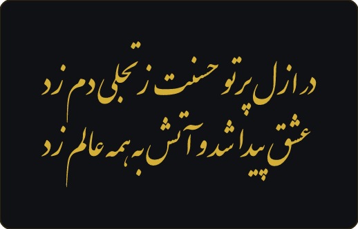

# nastaliq-bot 🖋️

ربات تلگرام و پلتفرم خوشنویسی نستعلیق آنلاین، کاملاً سرورلس بر بستر **Cloudflare Workers** با بهره‌گیری از **WebAssembly (HarfBuzz + Resvg)** بدون نیاز به هیچ سرور اختصاصی یا گیت‌هاب اکشنز.

A modern, 100% serverless Telegram bot and web platform that renders Persian text in authentic **Nastaliq calligraphy** directly inside **Cloudflare Workers** using **WebAssembly (HarfBuzz + Resvg)** — responding in milliseconds with zero external servers.

**[فارسی ⬇️](#فارسی)** | **[English ⬇️](#english)**

---

<p align="center">
  <a href="https://t.me/IRnastaliqbot">
    
  </a>
  <a href="https://nastaliq.startstar.ir">
    
  </a>
  
</p>

<p align="center">
  
  
</p>

---

## فارسی

### معماری جدید (۱۰۰٪ سرورلس روی Cloudflare Workers)

نسخه جدید این پروژه برخلاف روش‌های قدیمی که به سرورهای سنگین یا GitHub Actions (با تأخیر ۳۰ ثانیه‌ای) وابسته بودند، **کاملاً درون Cloudflare Workers** اجرا می‌شود:

```
کاربر در تلگرام / وب
         │
         ▼
 Cloudflare Worker (Edge)
         ├─ 1. دریافت وبهوک تلگرام یا درخواست وب
         ├─ 2. حروف‌چینی و اتصال حروف با HarfBuzz (WebAssembly)
         ├─ 3. استخراج مسیرهای برداری فونت (IranNastaliq / NotoNastaliq)
         ├─ 4. تبدیل مستقیم بردارها به تصویر PNG با Resvg (WASM)
         └─ 5. ارسال بلادرنگ عکس با متد sendPhoto تلگرام (< 1 ثانیه)
```

### امکانات

- ⚡ **سرعت فوق‌العاده:** تولید تصویر خطاطی زیر ۵۰ میلی‌ثانیه بدون هیچ صف یا تأخیر
- 🖋️ **اتصالات اصیل نستعلیق:** شبیه‌سازی کرسی‌ها و کشیده‌های واقعی با موتور حرفه‌ای HarfBuzz
- 🎨 **تم‌های رنگی چشم‌نواز:**
  - `gold`: طلا و زر روی پس‌زمینه مخملی تیره
  - `classic`: مرکب مشکی روی کاغذ کاهی کهن
  - `night`: شب نیلی و مهتابی
  - `rose`: گل سرخ درباری
  - `emerald`: زمردین فاخر
  - `azure`: لاجورد سلطنتی
- 💾 **ذخیره ترجیحات در Cloudflare KV:** امکان تنظیم فونت و تم دلخواه برای هر چت
- 🌐 **وب‌اپلیکیشن دمو و API:** صفحه تحت وب با رابط کاربری فارسی و کارگاه نگارش زنده در `https://nastaliq.startstar.ir`

### دستورات ربات تلگرام (`@IRnastaliqbot`)

| دستور | عملکرد |
|---|---|
| `/start` یا `/help` | راهنمای کامل استفاده و ارسال یک قطعه خطاطی خوش‌آمدگویی |
| `/fonts` | مشاهده فهرست فونت‌های نستعلیق موجود |
| `/themes` | مشاهده فهرست تم‌های رنگی |
| `/font iran` یا `/font noto` | تغییر و ذخیره فونت پیش‌فرض کاربر |
| `/theme <name>` | تغییر و ذخیره تم رنگی پیش‌فرض کاربر |
| _(هر متن یا بیت شعر)_ | رندر فوری متن ارسالی به خط نستعلیق |
| `font=noto theme=gold: متن` | اعمال تنظیمات دلخواه موقت فقط برای همین رندر |

### نحوه استقرار (Deploy)

۱. وارد پوشه `worker` شوید:
   ```bash
   cd worker
   npm install
   ```
۲. فایل `wrangler.toml` را با تنظیمات اکانت و کلید ربات تلگرام خود بررسی کنید:
   ```toml
   name = "nastaliq-bot"
   main = "src/index.js"
   compatibility_date = "2026-08-01"
   compatibility_flags = ["nodejs_compat"]

   [vars]
   TELEGRAM_BOT_TOKEN = "your-bot-token"

   [[kv_namespaces]]
   binding = "PREFS"
   id = "your-kv-namespace-id"
   ```
۳. فونت‌ها را در صورت نیاز داخل KV قرار دهید یا مستقیماً مستقر کنید:
   ```bash
   npx wrangler deploy
   ```
۴. وبهوک تلگرام را به ورکر متصل نمایید:
   ```bash
   curl -X POST "https://api.telegram.org/bot<TOKEN>/setWebhook?url=https://<your-worker>.workers.dev"
   ```

---

## English

### Architecture (100% On-Edge with WebAssembly)

Unlike previous setups that relayed jobs through external CI runners, this implementation executes **entirely on Cloudflare Workers**:
- **HarfBuzz WASM:** Performs proper Arabic/Persian contextual shaping, ligatures, and cursive attachment.
- **OpenType Engine:** Extracts exact vector glyph paths directly from TrueType font tables.
- **Resvg WASM:** Blazing-fast vector rasterizer compiling SVG directly to PNG buffers in ~15ms.

### Web Demo & API
- **Live Website:** [nastaliq.startstar.ir](https://nastaliq.startstar.ir)
- **Render API:**
  ```bash
  curl -X POST "https://nastaliq-bot.a77aslani.workers.dev/api/render" \
    -H "Content-Type: application/json" \
    -d '{"text":"به نام خداوند جان و خرد","theme":"gold","fontSize":54}' \
    -o calligraphy.png
  ```

### License
MIT License — Copyright (c) aliaslany / startStar
